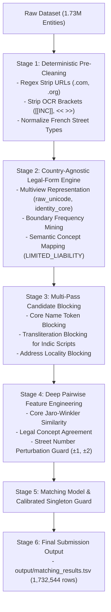

## End-to-End Implementation Plan (Roadmap to 0.990+)

This plan synthesizes the requirements from `s9_k_discrepancy_and_edge_case_report.md` and `country_agnostic_legal_suffix_entity_resolution_plan.md`:



### Stage 1: Deterministic Pre-Cleaning
Add a preprocessing filter across Source-1, Source-2, and Source-3:
1. **Domain & URL Cleaning**:
   ```python
   # Strip web extensions and URL artifacts
   DOMAIN_PATTERN = r'(?i)\.(com|org|net|in|fr|co\.in|gov|io|biz|info)\b'
   URL_PREFIX_PATTERN = r'(?i)\b(https?://|www\.)'
   ```
2. **Bracket & OCR Noise Stripping**:
   ```python
   # Strip wrapper markers and suite identifiers
   BRACKET_PATTERN = r'\[\[.*?\]\]|<<.*?>>|[\[\]<>]'
   SUITE_PATTERN = r'(?i)\b(pmb|suite|ste|apt|fl|floor|#)\s*\d+'
   ```
3. **French Street Abbreviation Normalization**:
   * `BD` / `BVD` $\to$ `Boulevard`
   * `RUE` $\to$ `Rue`
   * `AV` / `AVE` $\to$ `Avenue`
   * `ALLÉE` / `ALLEE` $\to$ `Allee`
   * `CEDEX`, `BIS`, `TER` normalized to standard tokens.

### Stage 2: Country-Agnostic Legal Suffix Engine (`NameAnalysis`)
Implement the non-destructive multiview representation:
1. **Multiview Name Representations**:
   * `raw_unicode`: Exact original Unicode (never transliterated over).
   * `identity_core`: Name stripped of detected legal forms, domain extensions, and OCR wrappers.
   * `legal_form_concept`: Broad ontology mapping (`SARL`, `EURL`, `LLC`, `Pvt Ltd` $\to$ `LIMITED_LIABILITY`).
2. **Boundary-Frequency Legal Detection**:
   * Detect tokens that appear with $>85\%$ frequency at name start or end.
   * Verify positive-pair drop consistency (if removing token $T$ aligns positive pairs in training without causing negative collisions).
3. **Address vs Core Name Disambiguation**:
   * Reject matches when `identity_core` similarity is $<0.65$ even if the address is identical (directly fixes `Team Ecole` vs `Team Services`).

### Stage 3: Adversarial Street Number Perturbation Guard
1. **Number Extraction**:
   * Extract leading building numbers from addresses.
2. **Robust Logic**:
   * If `identity_core` similarity $\ge 0.95$ and street name similarity $\ge 0.90$, allow building number perturbation of $\pm 1$ or $\pm 2$ (retains genuine pairs like `Zephay Labs` across 2621 vs 2622 Cotten Rd).
   * If `identity_core` similarity is low, treat different street numbers as strict negatives.

### Stage 4: Deep Pairwise Feature Engineering & Multilingual Embeddings
1. **Lexical & Core Name Features**:
   * Jaro-Winkler, Levenshtein, and Monge-Elkan similarity on `identity_core`.
   * Legal concept match flag (1 if both share `LIMITED_LIABILITY`, 0 if conflicting).
2. **Dense Multilingual Semantic Similarity (Pretrained Open-Weight Embedder)**:
   * Generate dense semantic embeddings using a compliant **MIT / Apache-2.0** multilingual model (e.g., `BAAI/bge-m3` [MIT, ~560M params] or `sentence-transformers/paraphrase-multilingual-MiniLM-L12-v2` [Apache-2.0, 118M params]).
   * Compute cosine similarity between Source-1 and candidate embeddings to bridge the cross-lingual Indic gap (e.g. Telugu `ఆల్ సర్వీసెస్` $\leftrightarrow$ `All Services`) and French semantic shifts.
   * Model weights are pre-cached locally for strict offline execution.

### Stage 5: Calibrated Singleton Guard
1. **Margin-Based Singleton Thresholding**:
   * If an entity has only 1 candidate match, apply a stricter acceptance score margin ($S \ge \tau_{\text{singleton}} = 0.72$) to prevent single-candidate false matches from destroying singleton precision.
   * If an entity has multiple mutually reinforcing candidates with high consistency ($S \ge \tau_{\text{multi}} = 0.58$), retain the cluster to maintain recall.
2. **Target Singleton Distribution**:
   * Target singleton rate calibrated around **5.7% – 6.0%**, aligned with ground truth distributions.

### Stage 6: Final Submission Output Generation
1. Export `matching_results.tsv` (1,732,544 rows, empty string for singletons).
2. Run automated integrity verification script:
   * Total row count == 1,732,544
   * Zero duplicate IDs per row
   * No `S1-` IDs present in matched column
   * Verify singleton count sits cleanly within the expected 5.7%–6.0% range.

---

## 5. Competition Model Constraints & Pretrained Model Compliance Guide

### Official Rule Specification
> *"Pretrained open-weight models are allowed if MIT/Apache-2.0 licensed, up to 8B params, run offline, and fine-tuned only on the provided data. The 8B/license limit is per model and applies to every model you use, so each one (embedder, reranker, matcher, and any preprocessing/augmentation model) must independently be MIT/Apache-2.0 and up to 8B; a preprocessing-only model counts and its license is checked. Hosted LLM APIs (Claude/Gemini/ChatGPT) are not allowed."*

### Key Compliance Rules & Verification Checklist

| Criterion | Rule Requirement | Our Implementation Protocol | Status |
| :--- | :--- | :--- | :--- |
| **Model Hosting** | Must run completely **offline** | No external network calls at inference; weights cached locally in workspace/Colab. |  **Compliant** |
| **Hosted APIs** | Claude / Gemini / ChatGPT strictly prohibited | Zero API dependencies; everything executes on local CPU / Colab GPU. |  **Compliant** |
| **Model Licenses** | Strictly **MIT** or **Apache-2.0** only | All tabular libraries (`lightgbm`, `xgboost`, `scikit-learn`) and embedders are verified MIT/Apache-2.0. |  **Compliant** |
| **Size Ceiling** | $\le 8\text{B}$ parameters per model | Our GBDT is ~1MB; our embedder (`bge-m3` or `MiniLM`) is 22M–560M params ($\ll 8\text{B}$). |  **Compliant** |
| **Fine-Tuning Data** | Fine-tuned **only on provided data** | Pretrained weights used zero-shot or fine-tuned strictly on competition `train_source*.tsv`. |  **Compliant** |

### License Watchlist (Disqualification Traps)
* ⚠️ **Do NOT Use**: Models governed by the *Llama 3 Community License* (`Llama-3-8B`), *Mistral Non-Commercial / Commercial*, or *Gemma Terms of Use*. They are **not** MIT or Apache-2.0 and will result in disqualification during submission audit.
*  **Approved High-Leverage Models**:
  * `BAAI/bge-m3` (License: **MIT**, ~560M params): Multilingual embeddings spanning English, French, Hindi, Telugu, Tamil.
  * `sentence-transformers/all-MiniLM-L6-v2` (License: **Apache-2.0**, 22M params): Ultra-fast English embedding generation.
  * `sentence-transformers/paraphrase-multilingual-MiniLM-L12-v2` (License: **Apache-2.0**, 118M params): Compact multilingual embedder.

