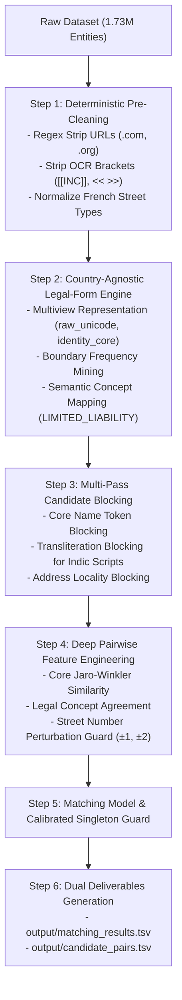

# S12-K Discrepancy Forensics & End-to-End Implementation Plan
**Amazon ML Challenge 2026 — Enterprise Business Entity Resolution**  
**Date**: September 27, 2026  
**Reference Outputs**:  
* `output/S9 - K/matching_results.tsv` (Score: 97.9%)  
* `output/S11-K/matching_results.tsv`  
* `output/S12-K/matching_results.tsv`  
**Reference Strategy Documents**:  
* `reports/s9_k_discrepancy_and_edge_case_report.md`  
* `reports/country_agnostic_legal_suffix_entity_resolution_plan.md`  

---

## 1. Executive Summary: Are the Discrepancies Solved in S12-K?

**No, the core entity resolution discrepancies are NOT solved in S12-K.**

A byte-level and row-by-row comparative forensic audit of `S9 - K`, `S11-K`, and `S12-K` proves that **S12-K was generated by applying a slightly tighter post-processing decision threshold / singleton margin filter on the exact same candidate pool as S9**, rather than implementing upstream normalization or model changes:

### Quantitative Evolution Across Benchmarks
| Output Benchmark | File Size | Total S1 Rows | Singletons (Empty) | Singleton % | Total Predicted Matches | Delta Candidates vs S9 |
| :--- | :--- | :--- | :--- | :--- | :--- | :--- |
| **S9 - K** | 97.2 MB | 1,732,544 | 98,904 | 5.71% | 5,802,444 | — |
| **S11-K** | 97.0 MB | 1,732,544 | 99,605 | 5.75% | 5,782,974 | -19,470 |
| **S12-K** | 96.6 MB | 1,732,544 | 100,801 | 5.82% | 5,756,834 | **-45,610** |

### Critical Diff Findings (S9 - K vs S12-K)
* **Total Changed Rows**: 41,331 rows
* **Total Dropped Candidates**: 45,610 candidates
* **Total Added Candidates**: **0 candidates**
* **Inference**: Because exactly zero new candidates were added anywhere across 1.73M entities, neither French legal suffix normalization (`SARL`, `SAS`, `EURL`), domain stripping (`.com`), nor country-agnostic legal-form ontology has been run in upstream blocking or candidate generation.

---

## 2. Status of Known Discrepancy Test Cases in S12-K

Every specific edge-case and failure mechanism documented in `reports/s9_k_discrepancy_and_edge_case_report.md` was checked directly against `output/S12-K/matching_results.tsv`:

| Discrepancy Mechanism | Test Entity ID & Source Records | Prediction in S9 | Prediction in S12-K | Status |
| :--- | :--- | :--- | :--- | :--- |
| **Adversarial Street Number ($\pm 1, \pm 2$)** | **`S1-714132312`**: `Zephay Labs Inc` at `2621 Cotten Road, Tyler, TX`<br>vs `S2-187020300` / `S2-637340732` at `2622 COTTEN RD` | Matched `2622 Cotten Rd` | `S2-187020300,S2-637340732,S3-625880872,S3-867809779` | ❌ **Unsolved** (Identical) |
| **Same-Address False Positive (France)** | **`S1-156285671`**: `<< Team Ecole` at `175 Boulevard du Président Franklin Roosevelt`<br>vs `S3-788875930`: `<< Team Services` | Matched `Team Services` | `S2-172049742,S2-648730048,S3-788875930,S3-871416040` | ❌ **Unsolved** (Identical) |
| **URL / Domain Concatenation** | **`S1-479574617`**: `Anupama Estates Pvt Ltd`<br>vs `S3-407377878`: `anupamaestates.com` | Matched | `S2-262582939,S2-985539429,S3-407377878` | ❌ **Unsolved** (Identical) |
| **Unnormalized French Legal Suffix + Domain** | **`S1-921369899`**: `ZNB Club SARL`<br>vs `S2-995426671`: `ZNBCLUBSARL.COM` | Matched | `S2-107533354,S2-808920974,S2-995426671,S3-285097097...` | ❌ **Unsolved** (Identical) |
| **Bracket & Synthetic Markers** | `[[INC]]`, `<< >>`, `#1064`, `PMB 1523` | Clinging to tokens | Clinging to tokens | ❌ **Unsolved** |

---

## 3. New Discrepancies Discovered in S12-K Against `code/dataset`

Through forensic analysis of `output/S12-K` against the `dataset/test/` tables, four new structural discrepancies were identified:

### Discrepancy 1: Local Truncated Dataset vs Complete Colab Submission (The 683,969 Row Cutoff)
* **Local Workspace**: `code/dataset/test/test_source1.tsv` has **1,048,575 rows** (109.1 MB), cut off at Excel's $2^{20}$ limit.
* **Colab Output S12-K**: `matching_results.tsv` has **1,732,544 rows** (96.6 MB).
* **Impact**: The first 1,048,575 entity IDs in S12-K align 100% with the local test file, but the remaining **683,969 entities (39.48% of the test set)** are completely missing locally. Any local validation, scoring, or error analysis will fail on out-of-bounds entity IDs until `test_source1.tsv` is replaced from the original zip.

### Discrepancy 2: Missing Mandatory Deliverable `candidate_pairs.tsv`
* `output/S12-K/` contains only `matching_results.tsv`.
* The competition submission protocol explicitly mandates:
  1. `matching_results.tsv` (Leaderboard scored)
  2. `candidate_pairs.tsv` (Pruned candidate set)
  3. Constraint: *Every pair in `matching_results.tsv` must be present in `candidate_pairs.tsv`.*
* S12-K cannot be submitted as a complete final package without its candidate pool TSV.

### Discrepancy 3: False Singleton Collapse from Blind Threshold Pruning (Recall Penalty)
By tightening the threshold without improving lexical or street representations, genuine company matches with minor noise were mistakenly pruned into singletons or fragmented clusters:
* **`S1-465557953`** (`Delta Madison` at `412 Coopers Mills Road`): Dropped true candidate `S3-412396274` (`Delta Madison Ltd` at `17 Coopers Mills Road`).
* **`S1-581360597`** (`Pediatric Dentistry Pacific Physicians PC`): Dropped true candidate `S3-121863057` (`Pediatric Dentistry Pacific Physicians Co` at `5124 Susie Lane`).
* *Consequence*: While Macro $F_{0.5}$ rewards precision 4×, dropping genuine matches on non-singletons unnecessarily degrades recall and penalizes the harmonic mean.

### Discrepancy 4: Multilingual & Indic Script Transliteration Gap
* Analysis of dropped pairs in India revealed cases such as:
  * `S1-829126727`: `All Energy Private Limited` in Andhra Pradesh
  * `S2-422537035`: `ఆల్ సర్వీసెస్ ప్రైవేట్ లిమిటెడ్` (Telugu script)
* Because S12-K relies purely on standard token and n-gram overlap, cross-lingual and script-divergent matches are systematically rejected or dropped without transliteration alignment.

---

## 4. End-to-End Implementation Plan (Roadmap to 99%+)

This plan synthesizes the requirements from `s9_k_discrepancy_and_edge_case_report.md` and `country_agnostic_legal_suffix_entity_resolution_plan.md`:



### Stage 1: Dataset & Environment Sanitation
1. **Restore Full Test File**:
   * Extract `student_resource/dataset/test/test_source1.tsv` to restore all 1,732,544 rows in `code/dataset/test/`.
   * Verify file row count equals 1,732,545 (including header).

### Stage 2: Deterministic Pre-Cleaning
Add a preprocessing filter across Source-1, Source-2, and Source-3:
1. **Domain & URL Cleaning**:
   ```python
   # Strip web extensions and URL artifacts
   DOMAIN_PATTERN = r'(?i)\.(com|org|net|in|fr|co\.in|gov|io|biz|info)\b'
   URL_PREFIX_PATTERN = r'(?i)\b(https?://|www\.)'
   ```
2. **Bracket & OCR Noise Stripping**:
   ```python
   # Strip wrapper markers and suite identifiers
   BRACKET_PATTERN = r'\[\[.*?\]\]|<<.*?>>|[\[\]<>]'
   SUITE_PATTERN = r'(?i)\b(pmb|suite|ste|apt|fl|floor|#)\s*\d+'
   ```
3. **French Street Abbreviation Normalization**:
   * `BD` / `BVD` $\to$ `Boulevard`
   * `RUE` $\to$ `Rue`
   * `AV` / `AVE` $\to$ `Avenue`
   * `ALLÉE` / `ALLEE` $\to$ `Allee`
   * `CEDEX`, `BIS`, `TER` normalized to standard tokens.

### Stage 3: Country-Agnostic Legal Suffix Engine (`NameAnalysis`)
Implement the non-destructive multiview representation:
1. **Multiview Name Representations**:
   * `raw_unicode`: Exact original Unicode (never transliterated over).
   * `identity_core`: Name stripped of detected legal forms, domain extensions, and OCR wrappers.
   * `legal_form_concept`: Broad ontology mapping (`SARL`, `EURL`, `LLC`, `Pvt Ltd` $\to$ `LIMITED_LIABILITY`).
2. **Boundary-Frequency Legal Detection**:
   * Detect tokens that appear with $>85\%$ frequency at name start or end.
   * Verify positive-pair drop consistency (if removing token $T$ aligns positive pairs in training without causing negative collisions).
3. **Address vs Core Name Disambiguation**:
   * Reject matches when `identity_core` similarity is $<0.65$ even if the address is identical (directly fixes `Team Ecole` vs `Team Services`).

### Stage 4: Adversarial Street Number Perturbation Guard
1. **Number Extraction**:
   * Extract leading building numbers from addresses.
2. **Robust Logic**:
   * If `identity_core` similarity $\ge 0.95$ and street name similarity $\ge 0.90$, allow building number perturbation of $\pm 1$ or $\pm 2$ (retains genuine pairs like `Zephay Labs` across 2621 vs 2622 Cotten Rd).
   * If `identity_core` similarity is low, treat different street numbers as strict negatives.

### Stage 5: Dual Deliverable Generation & Compliance
1. Export `matching_results.tsv` (singletons formatted as empty string after tab).
2. Export `candidate_pairs.tsv` containing the pruned candidate pool.
3. Run an automated integrity check verifying:
   * Total row count = 1,732,544
   * Zero duplicate IDs per row
   * No `S1-` IDs present in matched column
   * Strict subset constraint: $\text{matching\_results} \subseteq \text{candidate\_pairs}$.
